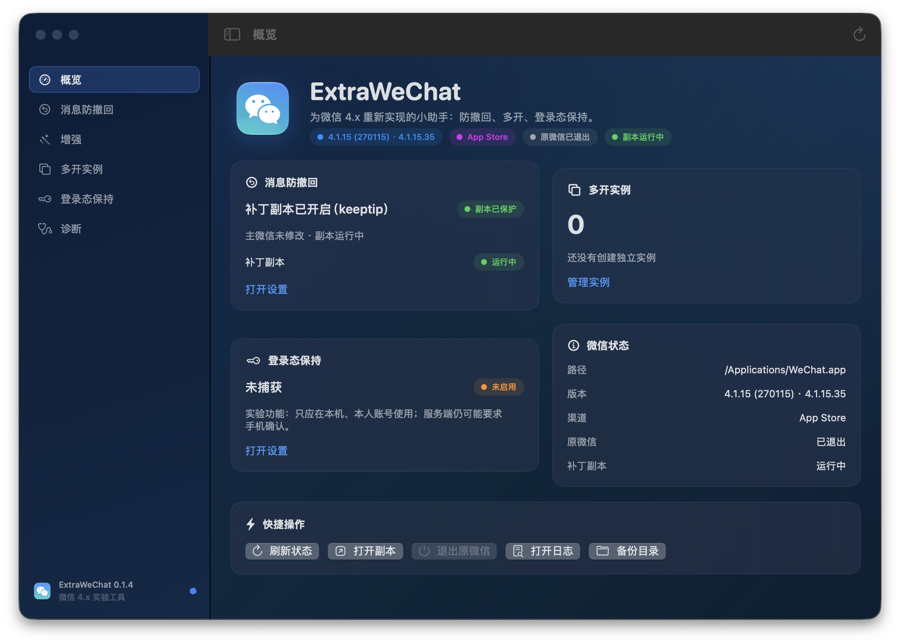

**给新版 macOS 微信重新实现「微信小助手」核心功能的工具。**

旧项目 [TKkk-iOSer/WeChatPlugin-MacOS](https://github.com/TKkk-iOSer/WeChatPlugin-MacOS) 依赖
Objective-C 注入，微信 4.x 改为 Qt/C++ 后已整体失效。本项目基于 4.x 的实际结构重新实现：

- **防撤回**：直接 patch `wechat.dylib`，不注入、不依赖旧 runtime；
- **多开**：复制 App + 新 bundle ID + 独立数据目录；
- **登录态保持**（实验）：在 `ilink2` 核心层 hook `autoauth` key；
- **GUI + CLI**：菜单栏/窗口 App，方便操作和 GitHub Release。



> **当前状态**
> - 微信 4.1.15（App Store，build 270115，arm64）已适配；
> - 防撤回已在副本上完成补丁 + 重签 + 签名验证；
> - 多开副本已实际启动验证；
> - 登录态保持 dylib 已能在副本中安装 hook，真实 key 捕获/注入待账号验收；
> - 尚未修改 `/Applications/WeChat.app`（安装器已就绪，等你确认/备份后使用）。

## 下载 / 构建 GUI

### 直接下载

从 GitHub Releases 下载：

- **`ExtraWeChat-0.1.1-arm64.pkg`（推荐）**：双击安装到 `/Applications`；
- `ExtraWeChat-0.1.1-arm64.zip`：便携版，解压后运行。

pkg 未公证，若被 Gatekeeper 拦截，右键 → 打开，或：

```bash
sudo installer -pkg ~/Downloads/ExtraWeChat-0.1.1-arm64.pkg -target /
```

zip 版首次打开前：

```bash
xattr -dr com.apple.quarantine ExtraWeChat.app
open ExtraWeChat.app
```

### 从源码构建

```bash
./scripts/build_app.sh
./scripts/build_pkg.sh
# 产物：
#   build/ExtraWeChat.app
#   build/ExtraWeChat-0.1.1-arm64.zip
#   build/ExtraWeChat-0.1.1-arm64.pkg
```

要求：macOS 13+、Xcode Command Line Tools、`/usr/bin/python3`（或 Python 3）。

## GUI 功能

| 页面 | 功能 |
| --- | --- |
| 概览 | 微信版本/构建/渠道、运行状态、防撤回/多开/登录态状态 |
| 消息防撤回 | silent / keeptip 选择、安装到主微信、还原、创建测试副本 |
| 多开实例 | 新建/启动/带登录态启动/删除独立实例 |
| 登录态保持 | 启用 allow-dyld-env、带 dylib 启动、查看 key 状态、清除 key、日志 |
| 诊断 | Python/tools/dylib 路径、补丁地址、备份状态、复制诊断 |

### 第一次使用

1. 完全退出微信（⌘Q，等待 helper 退出）。
2. 打开 ExtraWeChat →「消息防撤回」→ 选择模式 →「安装到主微信」。
   - 会备份原始 `wechat.dylib` 到 `~/Library/Application Support/ExtraWeChat/backups/`；
   - 会逐对象保留 entitlements 并重签；
   - 失败会拒绝写入，支持「还原微信」。
3. 重新打开微信，让对方发一条消息并撤回，确认消息保留。
4. 想还原：退出微信 →「还原微信」。

> 修改 `/Applications/WeChat.app` 需要两层权限：
>
> 1. **root**：微信由系统安装，属主是 `root:wheel`。GUI 会弹出 macOS 管理员授权对话框；
>    CLI 需要 `sudo`。
> 2. **App 管理**：系统设置 → 隐私与安全性 → App 管理 → 打开 ExtraWeChat。
>    如果列表里没有它，先把 `ExtraWeChat.app` 放到 `/Applications` 并启动一次，再重试；
>    使用 CLI 时还需要给终端同样的权限。
>
> `sudo` 不能绕过「App 管理」权限，两层都需要满足。

## CLI（可选）

```bash
# 只读定位，不改任何文件
python3 tools/locate_revoke.py --app /Applications/WeChat.app

# 在主微信上安装/还原（需要先退出微信；需要 root + App 管理权限）
sudo python3 tools/install.py install --app /Applications/WeChat.app --variant silent
sudo python3 tools/install.py restore --app /Applications/WeChat.app
python3 tools/install.py status  --app /Applications/WeChat.app --json

# 在副本上测试
python3 tools/patch_copy.py \
  --app /Applications/WeChat.app \
  --output ~/Applications/WeChat-Test.app \
  --variant silent

# 多开副本
python3 tools/patch_copy.py \
  --app /Applications/WeChat.app \
  --output ~/Applications/WeChat-2.app \
  --variant none \
  --clone 2
```

`--variant`：

- `silent`：消息保留，不显示撤回提示（默认，最稳）；
- `keeptip`：消息保留，私聊仍显示撤回提示；群聊提示有原生限制；
- `none`：只复制/重签，不打防撤回。

## 登录态保持（实验）

微信 4.x 的登录核心在 `ilink2.framework`：

- `TdiAutoLoginAsync` 从 `TdiContext` 的 `ini_file` 读取 `kTdiKeyAutoauthKey`；
- key 为空 → 打印 `autoauth_key is empty, require manual login!` 并回退手机确认；
- 本项目的 dylib hook `owl::v9::ini_file::get/set`，捕获/恢复 key。

```bash
# 1. 构建 dylib
tools/login_persist/build.sh

# 2. 做一个允许 DYLD 注入的副本（主 App 副本，保留原 bundle ID/沙盒）
python3 tools/patch_copy.py \
  --app /Applications/WeChat.app \
  --output ~/Applications/WeChat-LoginTest.app \
  --variant none --allow-dyld-env --force

# 3. 完全退出微信后启动
EXTRAWECHAT_LOGIN_DEBUG=1 tools/login_persist/run.sh ~/Applications/WeChat-LoginTest.app
```

- 详细步骤、日志路径和风险见 [`tools/login_persist/README.md`](tools/login_persist/README.md) 与
  [`docs/LOGIN-PERSISTENCE.md`](docs/LOGIN-PERSISTENCE.md)。
- key 保存在 `login_keys.tsv`（0600）；**这是登录凭据，不要外传**。
- 「锁定状态退出」是微信的安全策略，服务端仍可能拒绝保存的 key；不能承诺稳定免验证。
- 正式版本应迁移到 Keychain；当前为原型。

## 支持矩阵（4.1.15 / 270115）

| 功能 | 状态 |
| --- | --- |
| 防撤回（silent / keeptip） | ✅ 副本验证通过；主 App 安装器已就绪，待你验收 |
| 多开（独立数据目录） | ✅ 副本启动验证通过；GUI 已封装 |
| 备份 / 还原 / 诊断 | ✅ 已实现 |
| 菜单栏 / GUI | ✅ 已实现（ad-hoc 签名，未公证） |
| 登录态保持 | ⚠️ 核心层 dylib 原型，hook 已验证；真实 key 捕获待账号验收 |
| 阻止自动更新 | ⚠️ App Store 版不适用；官网版后续实现 |
| 自动回复 / 远程控制 | ❌ AX 读不到聊天内容；OCR 仅实验 |
| 聊天记录导出 | ❌ 加密数据库，不做 |

## 已知限制

1. 微信更新会整包替换并清除补丁；更新后需重新安装。
2. 修改微信违反腾讯用户协议，存在账号风险；只在本人设备、本人账号使用。
3. 当前只适配 4.1.15（270115）；其他构建可尝试只读定位，未验证勿直接安装。
4. 登录态保持不保证服务端接受；失败时仍会要求手机确认。
5. GUI 依赖 `/usr/bin/python3` 执行安装/定位脚本；纯 Swift 引擎是后续计划。
6. 不要分发打补丁后的 `WeChat.app`；只分发 ExtraWeChat 工具本身。

## 目录

- `app/`：SwiftUI GUI
- `tools/`：定位/安装/副本/登录态脚本
- `tools/login_persist/`：登录态 dylib + Frida 诊断原型
- `docs/`：可行性、测试、补丁点、登录态、路线图
- `scripts/`：构建 GUI / 图标 / Release

## 致谢 / 许可

4.x 的补丁点、几何签名和重签思路来自以下公开项目：

- [fzlzjerry/wechat-antirecall](https://github.com/fzlzjerry/wechat-antirecall)
- [zengtianli/WeChatTweak](https://github.com/zengtianli/WeChatTweak)（AGPL-3.0）
- [sunnyyoung/WeChatTweak](https://github.com/sunnyyoung/WeChatTweak)（AGPL-3.0）
- 旧项目 [TKkk-iOSer/WeChatPlugin-MacOS](https://github.com/TKkk-iOSer/WeChatPlugin-MacOS)（MIT）

本项目代码以 **AGPL-3.0** 发布。详见 [`LICENSE`](LICENSE) 和 [`NOTICE.md`](NOTICE.md)。
